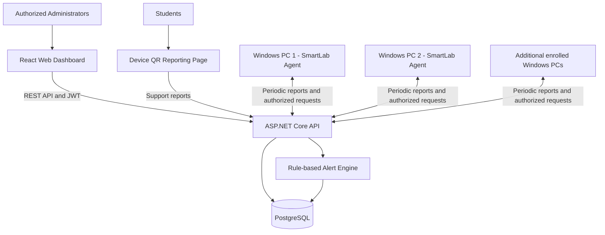

# SmartLab

### Intelligent Computer Laboratory Management & Security Monitoring System

**One Platform. Every Lab. Full Visibility.**

**University of Babylon · College of Information Technology · Department of Cybersecurity**

[Overview](#overview) · [Features](#key-features) · [Architecture](#system-architecture) · [Validation](#prototype-validation) · [Demo](#project-demonstration)

---

## Overview

SmartLab is a functional software prototype designed to modernize the management of computer laboratories in educational institutions. It brings device inventory, endpoint health monitoring, security alerts, technical support and administrative analytics into a single web-based platform.

A dedicated Windows service, **SmartLab Agent**, collects information from enrolled computers and periodically communicates with a central backend. Authorized administrators can inspect laboratory devices, review their security posture and track technical problems without having to visit each workstation individually.

> SmartLab transforms fragmented, manual laboratory management into centralized, data-driven operations.

## The Problem

Managing computer laboratories manually becomes increasingly difficult as the number of computers and laboratories grows. Administrators need to know which machines are available, which software is installed, whether security controls are enabled, and which technical issues require attention.

| Traditional challenge | SmartLab approach |
| --- | --- |
| Manual inspection of individual computers | Centralized device inventory and periodic reporting |
| Limited visibility into device availability | Online/offline status and last-seen information |
| Fragmented hardware and software records | Automatically collected device and software inventory |
| Delayed discovery of security configuration issues | Rule-based alerts and security health monitoring |
| Unstructured fault reporting | Device-specific QR reporting and tracked support tickets |
| Difficulty prioritizing maintenance | Laboratory health indicators and administrative analytics |

## Key Features

### 1. Centralized laboratory management

- A dashboard with device availability, laboratory counts, open tickets, active alerts and health indicators.
- Department and laboratory organization with role-based access.
- Laboratory enrollment codes for authorized Windows Agent registration.

### 2. SmartLab Agent & device inventory

- Background Windows service developed in C#.
- Automatic device registration and machine identity reporting.
- Periodic heartbeat, hardware, software and security health synchronization.
- Hardware and network details, installed applications, resource utilization and last-seen information.

### 3. Endpoint health & security monitoring

- CPU, memory and storage utilization monitoring.
- Microsoft Defender and Windows Firewall status.
- Windows Update status and pending restart indicators.
- Security and health information presented in a centralized device workspace.

### 4. Smart Alert Engine

- Automated, rule-based detection of offline devices, high resource utilization and selected Windows security configuration issues.
- Severity classification and alert history to help administrators prioritize investigation.
- Alert analytics and trends for operational awareness.

The alert engine uses deterministic rules; it is not a trained AI model or a replacement for endpoint detection and response (EDR).

### 5. QR-based technical support

- A unique device-specific QR reporting link.
- Students can report issues without an administrative account.
- Reports are associated with the relevant computer and categorized by problem type.
- Authorized staff can assign, track and resolve support tickets.

### 6. Controlled remote administration

- Authorized Department Heads can submit supported software-management requests to enrolled Agents.
- Command history records status and results; pending requests can be cancelled before execution.
- Device-side safety controls restrict execution. Software removal is disabled by default and remains a limited pilot capability, not general-purpose remote execution.

### 7. Analytics & decision support

- Online/offline device coverage and laboratory health indicators.
- Alert trends, alert categories and support ticket status.
- Centralized visibility to support maintenance prioritization and resource planning.

## System Architecture

SmartLab follows an Agent–Server architecture with a browser-based management interface and a centralized relational database.

The browser communicates with the API rather than directly with the database. Enrolled Agents authenticate individually, report device information and retrieve supported administrative requests. The server processes these data and exposes authorized views through the dashboard.

## Technology Stack

| Layer | Technology |
| --- | --- |
| Frontend | React, TypeScript, Vite |
| Backend | C#, ASP.NET Core 9, REST API |
| Data access | Entity Framework Core, Npgsql |
| Database | PostgreSQL 16 |
| Endpoint Agent | .NET 9 Windows Service, C# |
| Agent installer | Inno Setup |
| Authentication | JWT and per-device Agent credentials |
| Database environment | Docker |
| Private network used for testing | Tailscale |

The table describes the prototype implementation, not a recommendation to deploy an unsupported runtime in production.

## Security by Design

SmartLab incorporates security controls appropriate to its prototype scope:

| Control | Purpose |
| --- | --- |
| Role-based access | Restrict administrative features according to assigned responsibilities |
| Department and laboratory scoping | Limit administrative visibility to authorized organizational resources |
| JWT authentication and password hashing | Protect administrative authentication |
| Device-specific credentials | Authenticate each enrolled Agent separately |
| Credential revocation | Allow authorized administrators to invalidate device credentials |
| Request rate limiting | Reduce abuse of authentication and public reporting endpoints |
| Restricted command processing | Avoid arbitrary remote shell execution and limit software-management operations |

These mechanisms are implemented in the prototype. Institutional deployment will require additional hardening, HTTPS configuration, security testing and operational review.

## User Roles

| Role | Responsibility |
| --- | --- |
| College Administrator | College-level department and administrative oversight |
| Department Head | Management of assigned departments' laboratories and devices, including authorized software-management requests |
| Laboratory Supervisor | Laboratory-level device and support operations within assigned scope |
| Student | Submit device-specific technical reports through the QR reporting interface |

## Prototype Validation

SmartLab has been developed and evaluated in controlled development environments using real Windows computers. The project documentation records the following results:

| Capability | Validation status |
| --- | --- |
| Agent enrollment and authentication | Demonstrated on a Windows development computer |
| Device heartbeat and software inventory | Observed in development testing |
| Remote command delivery and result reporting | Validated in safe test mode |
| Pending command cancellation | Validated before Agent execution |
| Restricted software removal | A one-off, explicitly approved package removal pilot was reported successful; general removal is not production-ready |
| Two-computer demonstration | Documented private-network setup using Tailscale |

The prototype has not yet been validated in a full university-wide deployment. No quantitative claims about time savings, scalability or incident detection accuracy are made without institutional measurements.

## Project Demonstration

The competition demonstration presents the following workflow:

1. Central dashboard and laboratory administration.
2. Enrolled devices, hardware information and installed software.
3. Device health, security monitoring and controlled remote management.
4. Smart alerts and technical support reporting through QR codes.
5. Support ticket management and administrative analytics.

**Demo video:** The public demonstration link will be added here once available.

<!-- Replace the sentence above with [Watch the SmartLab demonstration](YOUR_PUBLIC_VIDEO_URL) after checking sharing permissions and removing any sensitive information from the video. -->

## Innovation & Expected Impact

The project's distinctive contribution is its integration of computer inventory, endpoint security visibility, QR-based support and administrative analytics into a workflow designed around educational laboratories and their organizational hierarchy.

SmartLab aims to:

- Reduce repetitive manual inspections and improve visibility across laboratories.
- Accelerate the reporting and prioritization of technical issues.
- Support proactive identification of selected endpoint configuration problems.
- Improve coordination between students, laboratory supervisors and department administrators.
- Provide operational information that supports maintenance and resource decisions.

These are intended benefits; their magnitude remains to be measured in a wider deployment.

## Roadmap

- Production HTTPS deployment, security hardening and migration to a supported .NET LTS runtime.
- Agent installer upgrades, offline recovery and more comprehensive automated tests.
- Controlled software installation and approved package catalog management.
- Active Directory integration and broader institutional deployment support.
- Pilot evaluation across multiple educational laboratories before larger-scale rollout.

## Developer & Academic Supervision

| | |
| --- | --- |
| **Developer** | Hussien Ahmed — Third-Year Cybersecurity Student |
| **Academic Supervisor** | Dr. Hassan Abdulameer |
| **Department** | Cybersecurity |
| **College** | College of Information Technology |
| **University** | University of Babylon, Iraq |
| **Year** | 2026 |

## Repository Scope & Intellectual Property

This public showcase presents SmartLab for academic, competition and portfolio purposes. The application source code, private configuration, credentials and deployment data are maintained separately and are not included in this repository.

No open-source license is granted by this showcase. Third-party components remain subject to their respective licenses.

---

**SmartLab — Towards Smarter, Safer and More Efficient Computer Laboratories.**

University of Babylon · 2026

